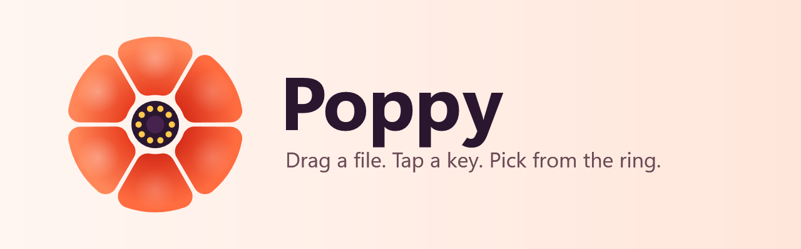
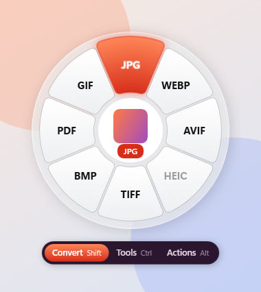
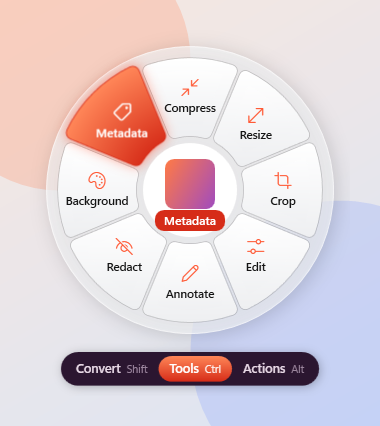
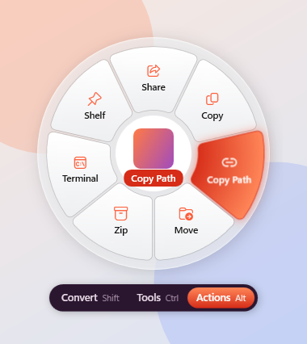
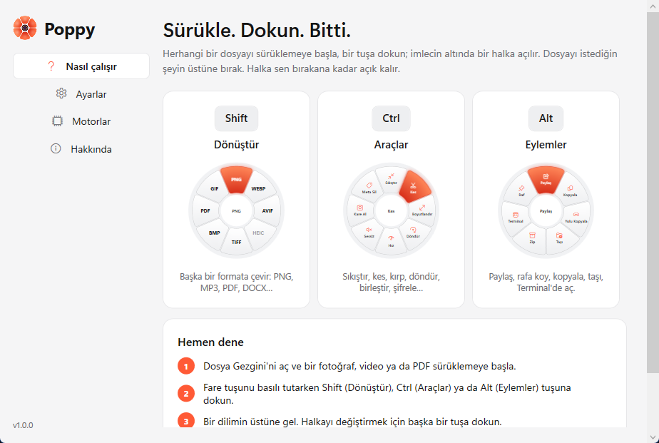

<p align="center">
  
</p>

<p align="center">
  <a href="https://kaanbahasever.github.io/Poppy/"><b>kaanbahasever.github.io/Poppy</b></a> · try the ring in your browser<br><br>
  <b>Poppy</b> is a ring of file tools that opens under your cursor while you drag a file in Windows.<br>
  Convert, compress, trim, crop, merge, share and more, without opening an app.
</p>

<p align="center">
  <a href="https://github.com/KaanBahaSever/Poppy/releases/latest"></a>
  <a href="LICENSE"></a>
</p>

---

## How it works

1. Start dragging any file or folder: in File Explorer, on the desktop, anywhere.
2. Keep holding the mouse button and **tap a key**:

   | Key | Ring | What it offers |
   |---|---|---|
   | <kbd>Shift</kbd> | **Convert** | Formats you can turn the file into: PNG, WEBP, MP3, MP4, PDF, DOCX… |
   | <kbd>Ctrl</kbd> | **Tools** | Compress, trim, crop, edit, rotate, merge, protect… |
   | <kbd>Alt</kbd> | **Actions** | Share, shelf, copy, move, copy path, open in Terminal, zip |

3. Move onto a segment and let go. The result is saved **next to the original**, and it never overwrites a file.

Tap another key while the ring is open to switch rings. <kbd>Esc</kbd> closes it, and dropping on the centre does nothing. You can change the keys in Settings.

<p align="center">
  
  
  
</p>

<p align="center"></p>

## Install

| | |
|---|---|
| **winget** | `winget install KaanBahaSever.Poppy` |
| **Installer** | [Poppy-win-Setup.exe](https://github.com/KaanBahaSever/Poppy/releases/latest) (no admin rights needed, updates itself) |
| **Microsoft Store** | The Store edition is the same app with Store updates; buying it supports development. |

Windows 10 (2004) or Windows 11, x64. FFmpeg (LGPL build) is bundled, so video and audio work out of the box.

## What it can do

### Convert ring

| Drop a… | Get |
|---|---|
| Image (PNG, JPG, WEBP, AVIF, HEIC, TIFF, BMP, GIF, ICO, SVG, PSD, RAW…) | PNG · JPG · WEBP · AVIF · HEIC · TIFF · BMP · PDF · GIF · ICO |
| Video (MP4, MKV, WEBM, MOV, AVI, WMV…) | MP4 · MKV · WEBM · MOV · AVI · GIF · MP3 · WAV |
| Audio (MP3, WAV, FLAC, M4A, OGG, OPUS…) | MP3 · WAV · FLAC · M4A · OGG · OPUS · AIFF · WMA |
| PDF | PNG · JPG · WEBP · TIFF (pages) · TXT (built-in Windows OCR, works on scans too) |
| Document (DOCX, DOC, ODT, RTF, MD, HTML, TXT) | PDF · DOCX · ODT · RTF · HTML · MD · TXT · EPUB |
| Slides (PPTX, PPT, ODP) | PDF · PNG · JPG · PPTX · ODP · MP4 |
| Spreadsheet (XLSX, XLS, ODS, CSV, TSV) | XLSX · CSV · PDF · JSON · HTML · TSV · ODS · XLS |
| E-book (EPUB) | PDF · DOCX · HTML · MD · TXT · ODT |
| Subtitles (SRT, VTT, ASS) | SRT · VTT · ASS · TXT |
| Archive, folder, anything | ZIP · 7Z · TAR · TAR.GZ |

Several images dropped on **PDF** become one PDF, one image per page in name order. When the codecs already fit, video is re-wrapped instead of re-encoded (MP4 → MKV takes a second).

### Tools ring

| For | Tools |
|---|---|
| Images | Compress · Metadata (strip EXIF/GPS) · Edit (brightness, contrast, saturation, rotate, flip, B&W) · Annotate (pen, highlighter, box, arrow) · Add background · Crop · Redact · Resize |
| Video | Compress · Trim (waveform timeline) · Mute · Resize · Rotate · Frame (snapshot) · Speed · Metadata |
| Audio | Compress · Trim · Normalize (EBU R128) · Mono · Fade · Speed · Metadata |
| PDF | Compress · Merge (name order) · Split (every page, every N pages or ranges) · Rotate · Extract pages · Protect (AES-256 password) · Metadata |
| Subtitles | Shift timing |
| Archives | Extract (zip-slip safe) |

### Actions ring

Share (Windows share sheet, Nearby Sharing) · Shelf (a floating shelf that holds files and snaps to a screen edge) · Copy · Move · Copy Path · Terminal · Zip. These work with folders and mixed selections too.

## Engines

Poppy handles images, PDFs, spreadsheets, subtitles and archives on its own. These programs add more. You never have to install them by hand: drop a file on a greyed-out petal and Poppy offers to install what it needs (through winget), then continues with your file. **Settings → Engines** also has an Install button for each.

| Engine | Adds |
|---|---|
| FFmpeg *(bundled)* | Video and audio |
| Microsoft Office *or* LibreOffice | Word, PowerPoint and Excel formats |
| Pandoc | Markdown, EPUB, HTML |
| Microsoft Edge *(built into Windows)* | Markdown/HTML/EPUB → PDF |
| HEVC Video Extensions *(Microsoft Store)* | Saving HEIC |
| 7-Zip | Creating .7z |
| Ghostscript | Stronger PDF compression |

## Build from source

```powershell
git clone https://github.com/KaanBahaSever/Poppy
cd Poppy
dotnet build Poppy.sln
dotnet run --project src/Poppy
```

Requires the .NET 10 SDK. Running the tests:

```powershell
dotnet test tests/Poppy.Core.Tests                       # every conversion and tool, on generated samples
dotnet run --project tests/Poppy.E2E -- src\Poppy\bin\Debug\net10.0-windows10.0.19041.0\win-x64\Poppy.exe
```

The end-to-end test drives real drag-and-drop with synthetic mouse and keyboard input, so don't touch the mouse while it runs.

Everything is built and tested locally; nothing runs on GitHub Actions (the two workflows exist only as a manual fallback). To ship a version: bump `<Version>` in `src/Poppy/Poppy.csproj`, write `docs/RELEASE_NOTES.md`, commit and push, then:

```powershell
./publish.ps1 -Version x.y.z
```

It runs the tests, builds the installer, the delta update package and the Store MSIX (`build.ps1`), and publishes the GitHub release.

### Project layout

```
src/Poppy.Core     conversion engine, ring catalog, gesture logic (no UI)
src/Poppy          WPF tray app: hooks, ring overlay, dialogs, shelf, settings
tests/             unit + conversion matrix tests, end-to-end drag test
tools/AssetGen     draws the logo, icon and Store tiles from vectors
packaging/         MSIX manifest, winget manifest templates
```

## Privacy

Everything runs on your PC. Poppy has no telemetry. The only network request is the GitHub edition checking GitHub Releases for updates.

## License

Poppy is free software under the [GNU GPL v3](LICENSE). The Poppy name and logo are not covered by the license: please use your own if you publish a fork.

---

### Türkçe

**Poppy**, Windows'ta bir dosyayı sürüklerken bir tuşa dokununca imlecin altında açılan bir araç halkasıdır. <kbd>Shift</kbd> **Dönüştür** halkasını (PNG, MP3, PDF, DOCX…), <kbd>Ctrl</kbd> **Araçlar** halkasını (sıkıştır, kes, kırp, birleştir, şifrele…), <kbd>Alt</kbd> da **Eylemler** halkasını (paylaş, raf, kopyala, taşı, yolu kopyala, terminal) açar. Dosyayı istediğin dilime bırakırsın; sonuç orijinalin yanına kaydedilir. Kurmak için: `winget install KaanBahaSever.Poppy`. Arayüz Türkçe ve İngilizce.
